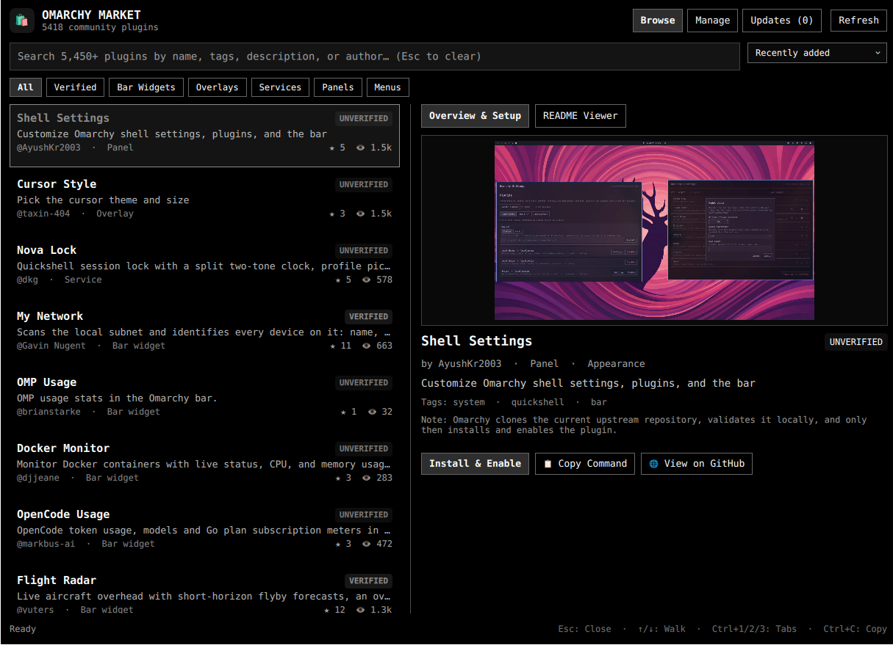
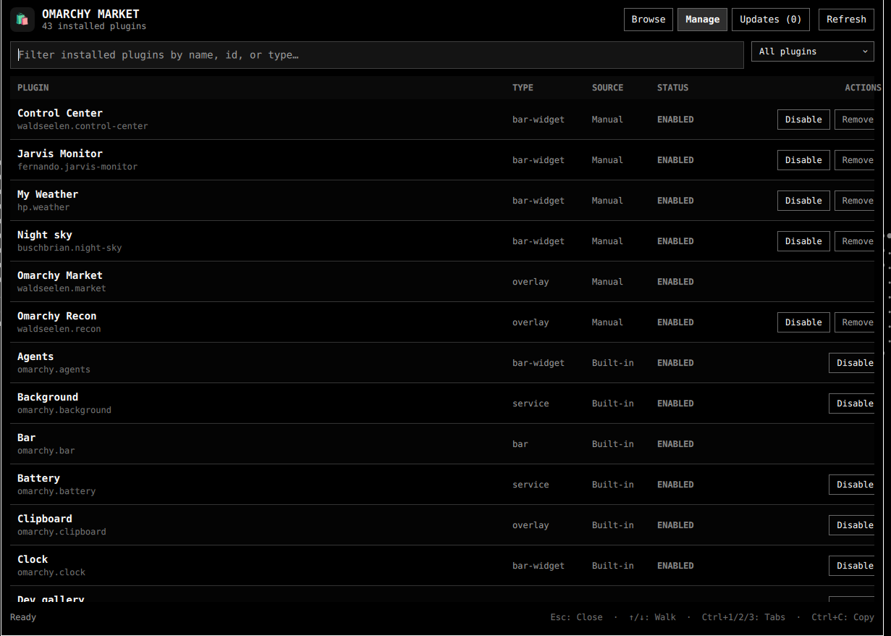

# Omarchy Market (waldseelen.market)

Next-generation native Quickshell plugin marketplace for Omarchy Quattro.

  

  

## Features & Improvements Over Standard Marketplace
- **Super+N Native Overlay**: Dedicated fullscreen modal overlay bound directly to `Super + N` with Esc / scrim click dismissal.
- **Live GitHub README Viewer**: Reads, caches (`~/.cache/omarchy/readmes/`), and renders complete GitHub READMEs with markdown formatting.
- **3-View Management Suite**:
  - **Browse**: 5,450+ plugins with instant category chips (All, Verified, Bar, Overlay, Service, Panel, Menu) and smart sorting (Stars, Views, Activity, Added).
  - **Manage**: Full inventory of installed plugins with 1-click Enable / Disable / Update / Remove.
  - **Updates**: Non-blocking Git commit comparison (`plugin-update-status`) and 1-click fast-forward updates with rollback protection.
- **Instant Cold Start**: Local cache hydration from `~/.cache/omarchy/plugins-catalog.json` loads 5,450+ plugins in 0ms, followed by background synchronization.
- **Safety First**: Commit-bound validation, repository URL whitelisting, and explicit confirmation dialogs before any third-party code installation.

## Keybindings
- `Super + N`: Toggle Marketplace Overlay
- `Esc`: Close overlay / Clear search
- `Ctrl + 1 / 2 / 3`: Switch between Browse, Manage, and Updates tabs
- `↑ / ↓`: Navigate plugin list
- `Ctrl + C`: Copy CLI install command to clipboard
